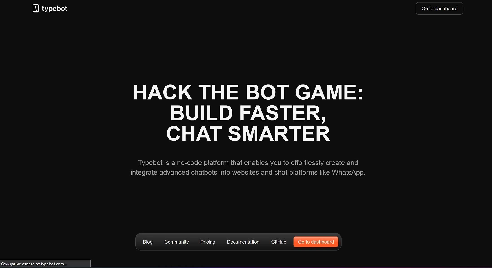
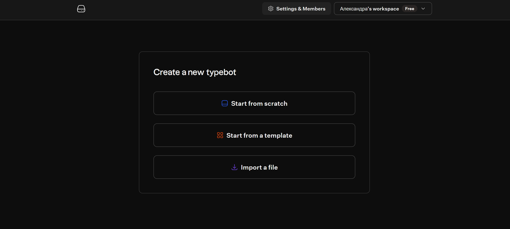
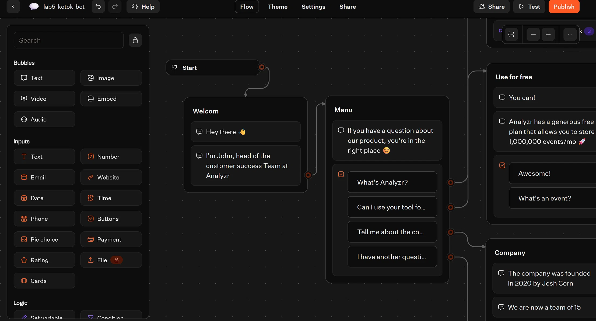
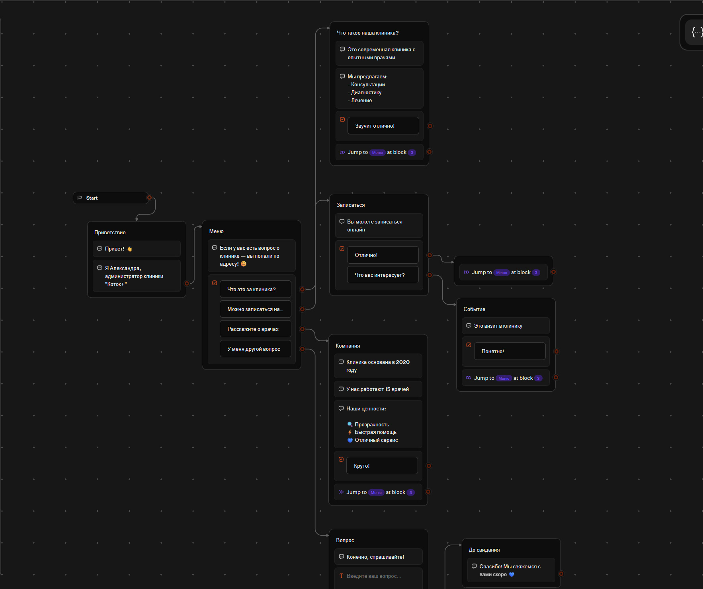
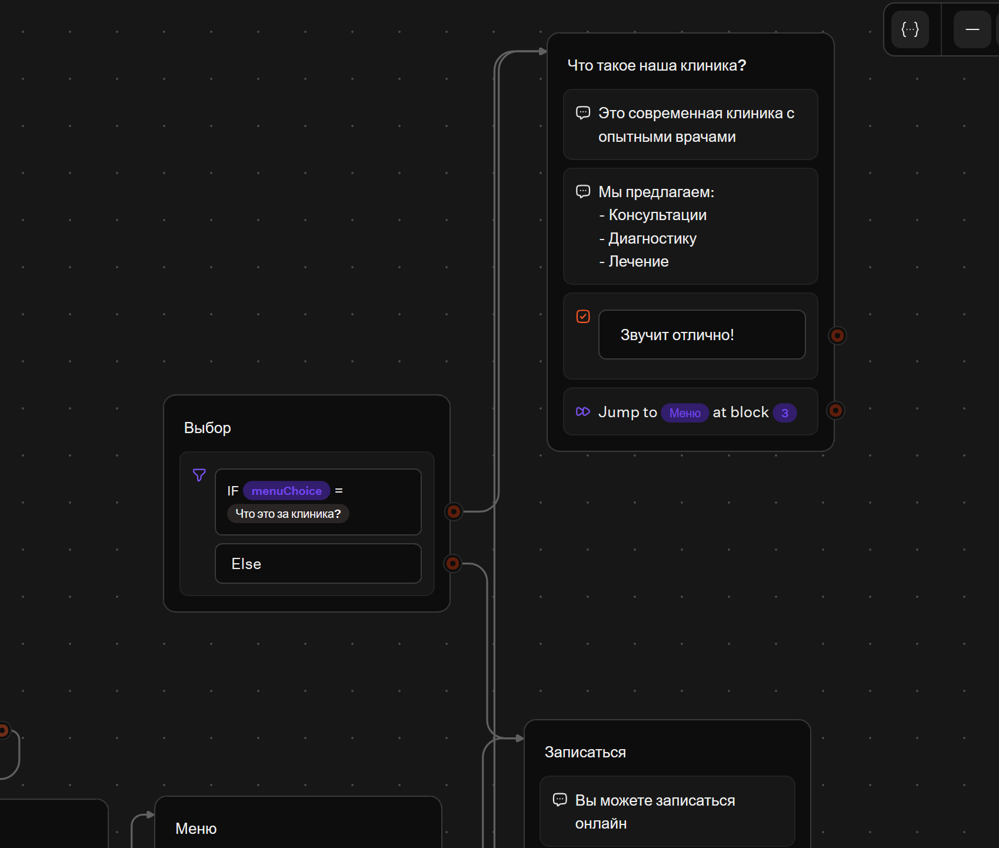
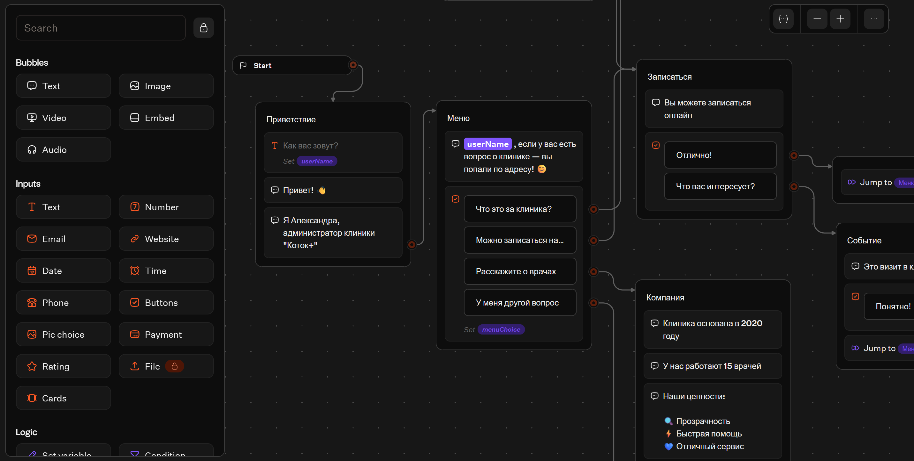
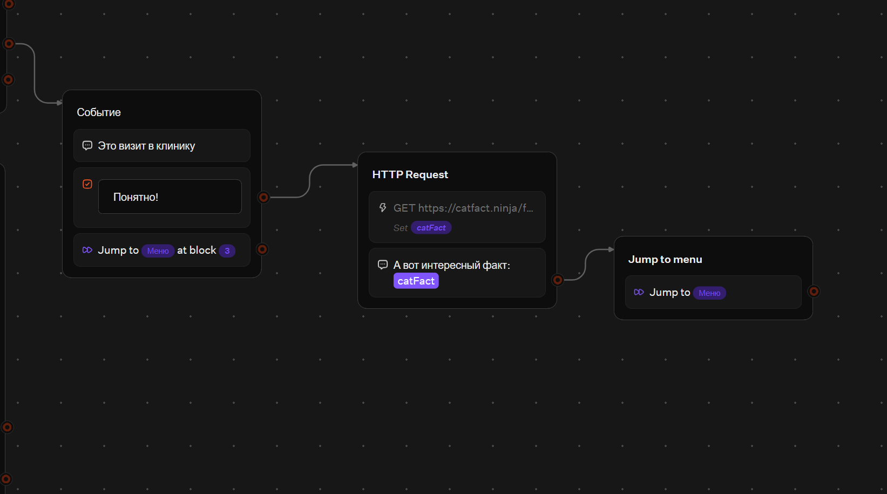
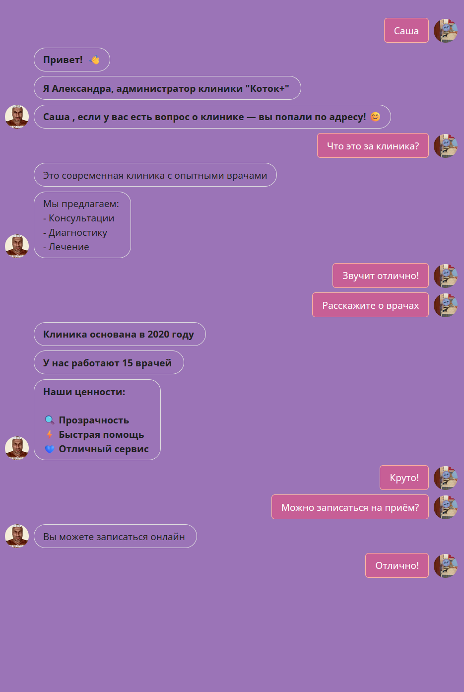
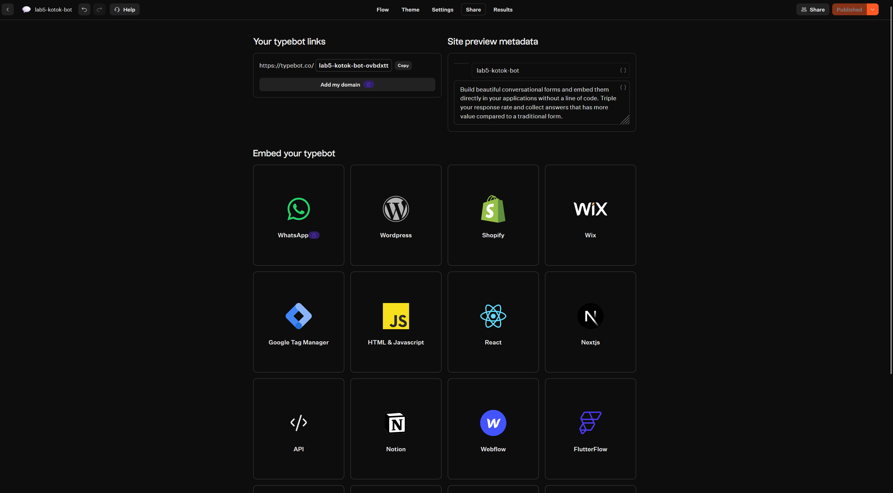

# Отчёт по лабораторной работе №5. Чат-боты (TypeBot)

**Студент:** Коток Александра · **Группа:** УИР-241

## Выбранный трек

**Трек C — TypeBot.** Платформа выбрана за:
- **Экспорт flow в JSON** (соответствует требованию задания).
- **200 чатов в месяц** на бесплатном тарифе (с запасом для тестирования).
- **Мощный визуальный редактор** — можно собрать сложную логику.
- **Не нужно приглашать 5 одногруппников** (в отличие от Botpress).

**Ссылка на бота:** [https://typebot.co/lab5-kotok-bot-ovbdxtt](https://typebot.co/lab5-kotok-bot-ovbdxtt)

## Какие AI-промпты использовались

- «Как зарегистрироваться в TypeBot и создать workspace?»
- «Как перевести шаблон TypeBot на русский, не сломав переменные?»
- «Как настроить Condition в TypeBot: проверить выбор кнопки?»
- «Как сохранить ответ пользователя в переменную TypeBot?»
- «Как сделать HTTP Request в TypeBot и вывести результат?»

## Освоенные блоки

### Bubbles (сообщения)
- **Text** — текстовое сообщение от бота.
- **Image** — картинка (если нужно).

### Inputs (поля ввода)
- **Text** — текстовый ввод (для имени пользователя).
- **Buttons** — кнопки выбора.

### Logic (логика)
- **Set variable** — сохранение значения в переменную.
- **Condition** — ветвление по условию.
- **Jump** — переход к другому блоку.

### Integrations (интеграции)
- **HTTP Request** — запрос к внешнему API.

## Что сделано

### 1. Регистрация и создание бота

- Зарегистрировалась на **typebot.io**.
- Создала workspace **`Александра's workspace`**.
- Создала бота **`lab5-kotok-bot`** из шаблона **`FAQ`** (про Analyze).

### 2. Русификация

Перевела **все тексты, кнопки, плейсхолдеры** с английского на русский:
- **Приветствие** — «Привет! Я Александра, администратор клиники "Коток+"».
- **Меню** — «Если у вас есть вопрос о клинике — вы попали по адресу!» + 4 кнопки.
- **Блоки** — «Что такое наша клиника?», «Записаться», «Компания», «Событие», «Вопрос», «До свидания».

### 3. Добавленные блоки и логика

**Condition (блок `Выбор`):**
- Проверяет: **`menuChoice = "Что это за клиника?"`**.
- **IF** → блок `Что такое наша клиника?`.
- **Else** → блок `Записаться`.

**Variable (переменные):**
- **`userName`** — сохраняется в блоке `Приветствие` (поле «Как вас зовут?»).
- **`menuChoice`** — сохраняется в блоке `Меню` (какую кнопку выбрал пользователь).
- **`catFact`** — сохраняется в блоке `HTTP Request` (факт про кошек).

**HTTP Request (блок `HTTP Request`):**
- **GET** `https://catfact.ninja/fact`.
- **Data**: `data.fact`.
- **Set variable**: `catFact`.
- **Результат**: «А вот интересный факт: {{catFact}}».

### 4. Тема и брендинг

- Изменён **цвет темы** (фиолетовый).
- Изменён **аватар бота**.
- Изменено **имя бота**.

### 5. Публикация

- Нажал **Publish**.
- Получена **web-ссылка**: [https://typebot.co/lab5-kotok-bot-ovbdxtt](https://typebot.co/lab5-kotok-bot-ovbdxtt).

## Скриншоты

### Регистрация

### Шаблон

### До перевода

### После перевода

### Condition

### Variable

### HTTP Request

### Тема

### Публикация

## Экспорт

Файл экспорта flow: **`exports/flow-01-lab5-kotok`**.

## Выводы

В ходе работы я освоила **TypeBot** как no-code платформу для создания чат-ботов. Научилась:
- **Работать с шаблонами** — выбрать и русифицировать.
- **Добавлять логику** — Condition, Variable, HTTP Request.
- **Настраивать тему** — цвет, аватар, имя.
- **Публиковать бота** — получать web-ссылку.
- **Экспортировать flow** — в JSON.

Главный практический вывод: **TypeBot** — удобный инструмент для создания чат-ботов. Он мощнее ManyChat, но сложнее. **Condition** и **Variable** позволяют делать **персонализированные сценарии**. **HTTP Request** — подключать внешние API.
