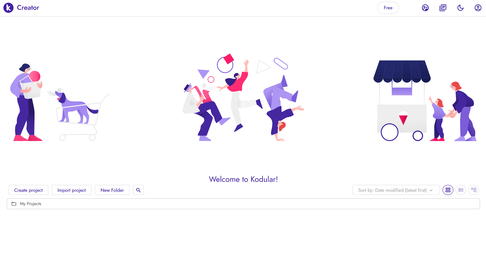
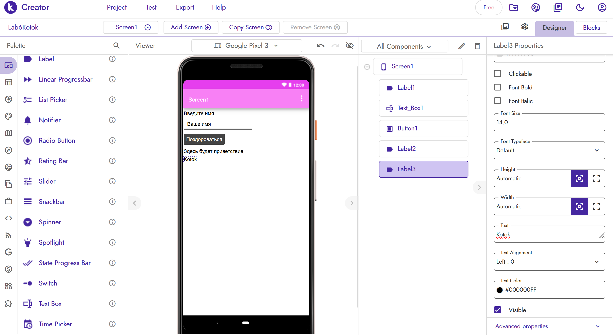
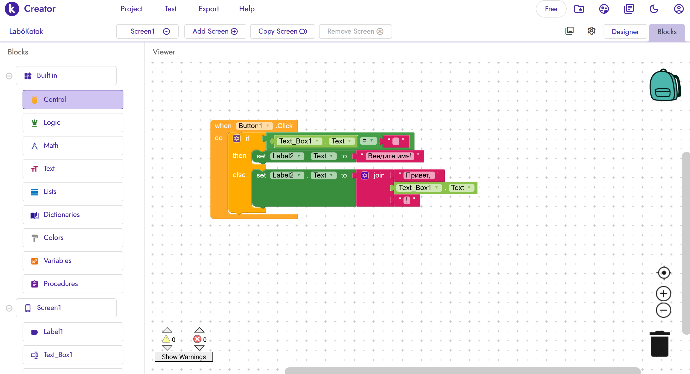
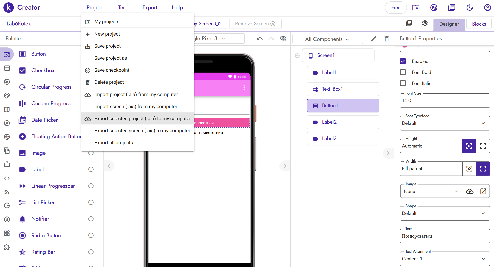

# Отчёт по лабораторной работе №6. Kodular

**Студент:** Коток Александра · **Группа:** УИР-241

## Краткое описание

Создала приложение **«Приветствие»** в Kodular. Приложение содержит:

- **Label1** — заголовок «Введите имя».
- **TextBox1** — поле ввода (Hint «Ваше имя»).
- **Button1** — кнопка «Поздороваться».
- **Label2** — для результата.
- **Label3** — с фамилией **`Kotok`** (видна на экране).

**Логика:** при нажатии на кнопку проверяется, пустое ли поле. Если пусто — «Введите имя!». Если нет — «Привет, <имя>!».

## Ссылка на проект

Проект **не опубликован** в Kodular Gallery. Файл `.aia` — в `exports/Lab6Kotok.aia`.

## AI-промпты

- «Как в Kodular сделать проверку на пустое поле TextBox?»
- «Как использовать блок join для соединения строк в Kodular?»
- «Как экспортировать проект Kodular в .aia?»
- «Как в Kodular разместить несколько Label на одном экране, чтобы они не слипались?»

## Освоенные компоненты и блоки

### Компоненты

- **Label** — текст (заголовок, результат, фамилия).
- **TextBox** — поле ввода.
- **Button** — кнопка.

### Блоки

- **`when Button1.Click`** — событие нажатия.
- **`if / then / else`** — условие.
- **`=`** — сравнение.
- **`join`** — соединение строк.
- **`set Label2.Text`** — установка текста.

## Скриншоты

### Регистрация

### Дизайн Screen1

### Блоки логики

### Экспорт `.aia`

## Ограничения бесплатного тарифа Kodular

- До **10 проектов**.
- До **10 МБ ассетов**.
- До **5 расширений**.
- **Брендинг Kodular** в приложении (нельзя убрать).

## Выводы

Освоила **Kodular** как no-code платформу для создания мобильных приложений. Научилась работать с **компонентами** (Label, TextBox, Button) и **блоками** (условие, join, событие нажатия).

**Kodular** — удобный инструмент для быстрого создания Android-приложений. Логика в блоках похожа на Scratch — визуальная и понятная. Единственное неудобство — на бесплатном тарифе нельзя убрать брендинг платформы.